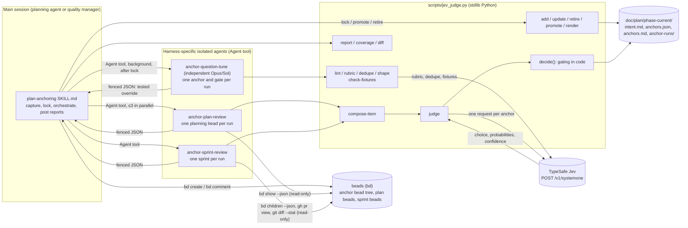
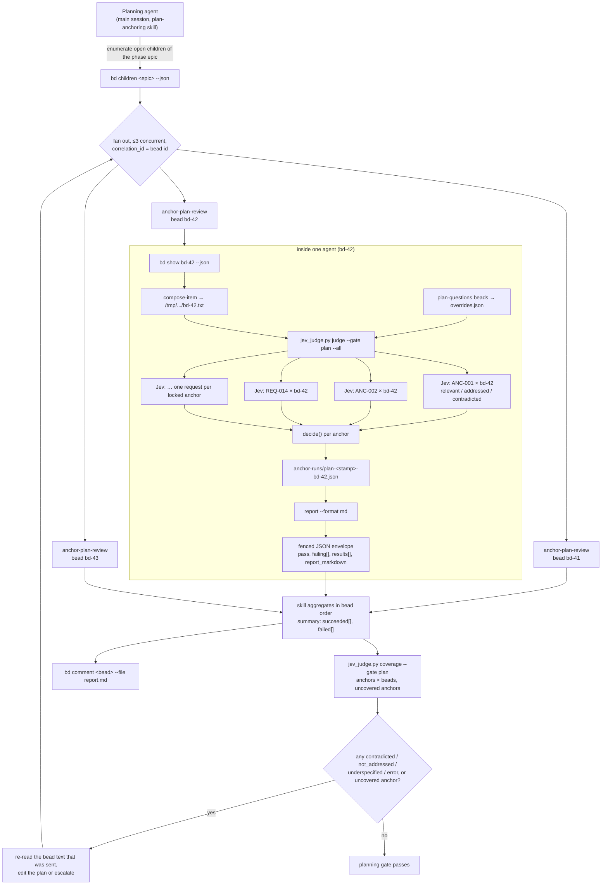
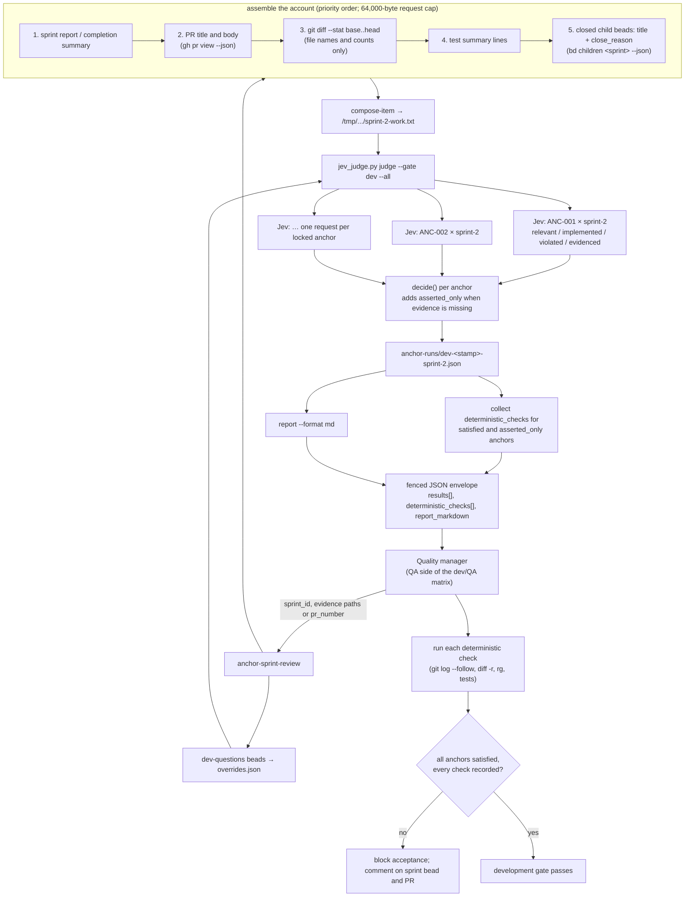
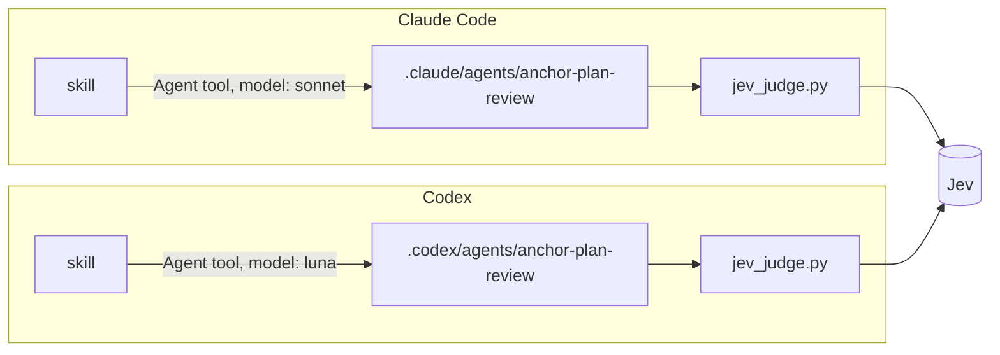

# Plan anchoring: architecture and call graphs

Design document for the `plan-anchoring` skill. Companion to the [PRD](../plan-anchor-prd.md) and to [data model, gating and lifecycle](data-model-and-gating.md). Diagrams are Mermaid.

Status: implemented and verified live against Jev `jev-1.13.0` on both gates. Revision 0.4 (2026-10-10) adds harness-specific agents, an independent Opus/Sol question tuner, repository-confined agent inputs, output credential redaction, and item-growth reporting. Marketplace manifests are pending.

## 1. Components

Three tiers, following the two-tier skill/agent architecture plus one external judge. Everything that must be exact lives in the script; everything that needs judgment lives in the main session or in Jev.



Responsibilities:

| Tier | Owns | Never does |
| --- | --- | --- |
| Skill (main session) | Detecting candidates, writing each as one testable statement with the verbatim quote kept, running the rubric and dedupe, locking through the script, spinning off the tuner, creating the bead tree, deciding what to judge, posting reports, triaging verdicts and oversized beads | Judging text itself, locking a statement that is just the quote, computing coverage or size by hand, splitting a bead to pass |
| Agents | Canonicalizing repository-local inputs through `agent-preflight`, composing the exact text Jev sees, resolving question overrides from beads, invoking the script once, returning fenced JSON; an independent Opus/Sol tuner derives a frozen oracle from approved intent/anchors and iterates one question per Jev round | Editing beads, the record, the plan or code; posting comments; retrying around the script; tuning to make the plan pass; changing the oracle after seeing Jev; executing an untrusted script path or reading external evidence |
| Script | IDs, agent path/identifier preflight, lint, rubric and dedupe requests, the Jev request, output credential redaction, retries, response validation, gating, run files, coverage, verdict and item-size diffs, shape metrics, report rendering | Calling `bd` or `gh`; deciding what to judge; shortening plan prose |
| Jev | Answering three or four independent typed questions about one anchor and one item | Counting, gating, explaining, seeing more than one item |

## 2. Planning gate call graph

Fan-out happens at two levels. The skill fans out across planning beads (at most three agents at once, one correlation ID each, aggregated in bead order). Inside each agent the script fans out across anchors, one Jev request per anchor, so Jev never sees two anchors or two beads together.



Request count is deterministic: locked anchors × planning beads. Twenty anchors across fifteen beads is 300 Jev requests, each about 100 ms and priced on input tokens only, so re-running after every plan edit is the intended cadence. The third identical failing run on one bead is a hard stop that escalates to the user instead of editing again.

## 3. Development gate (sprint review) call graph

The same anchors, judged against an account of delivered work instead of the plan. The quality manager drives it, the agent assembles evidence in a fixed priority order, and the development question set adds an evidence question so a claim of compliance is separated from a demonstration of it.



The two gates are separate because they judge different things. An anchor that was faithfully planned and then abandoned in code passes the planning gate and fails here. Jev only confirms the account *describes* following the directive; the paired deterministic check confirms the code did.

## 4. One judge invocation, with retries

Every call to Jev goes through the script, which owns the attempt policy. Agents call the script once and never add a retry loop of their own, so the behavior is identical under Claude Code and Codex.

```mermaid
sequenceDiagram
    autonumber
    participant Ag as anchor-*-review agent
    participant S as jev_judge.py judge
    participant J as Jev API

    Ag->>S: --gate, --item-file, --overrides-file, --all
    S->>S: validate anchors.json, load question set, merge overrides
    S->>S: fail closed unless TYPESAFE_API_KEY and PLAN_ANCHOR_ALLOW_REMOTE_JUDGE=1

    loop for each locked or promoted anchor
        S->>S: build state {anchor, item}; plan: fit whole/reduce code or refuse; dev: shorten evidence to ≤64,000 bytes
        loop up to 3 attempts
            S->>J: POST /v1/systemone {model, state, questions}
            alt 200 and response validates
                J-->>S: answers {choice, probabilities, confidence}
                S->>S: decide() → verdict, min_confidence
            else 422 token limit exceeded
                J-->>S: max_tokens_exceeded
                S->>S: halve item text (keep head, mark truncation), retry<br/>stop at 2,000 chars → verdict error JEV.CONTEXT_EXCEEDED
            else 429 / 529 / 5xx / network / invalid response
                J-->>S: transient failure
                S->>S: wait Retry-After or 1 s, then 2 s, next attempt<br/>after 3 attempts → verdict error (JEV.*)
            else 401
                J-->>S: unauthorized
                S-->>Ag: abort run, AUTH.CREDENTIALS (never retried)
            end
        end
        S->>S: record answers, attempts, item_chars_sent, questions_sha256
    end

    S->>S: sort by severity, summary {counts, failing, pass}
    S->>S: write anchor-runs/<gate>-<stamp>-<item>.json
    S-->>Ag: JSON {success, data: {run_path, results, summary}}, exit 0 pass, 1 fail, 2 fatal
    Ag->>S: report --run <run_path> --format md
    S-->>Ag: markdown with each failing anchor's statement and verbatim quote
    Ag-->>Ag: return fenced JSON envelope to the skill
```

Policy summary:

| Situation | Behaviour | Where |
| --- | --- | --- |
| Planning request too large before sending | Keep prose intact; reduce the fewest eligible long code blocks, longest first; return `PLAN.TOO_LARGE` if it still does not fit | script pre-flight |
| Development request too large before sending | Shorten the evidence account from the tail to fit 64,000 bytes, keep the head, mark truncation | script pre-flight |
| Jev reports the context window exceeded (422) | Planning: `PLAN.TOO_LARGE`; development: halve evidence and retry, stopping below 2,000 characters with `JEV.CONTEXT_EXCEEDED` | script, per anchor |
| 429, 529, 5xx, timeout, network error, malformed response | At least two more attempts (three total) with `Retry-After` or 1 s then 2 s backoff; then `verdict: error` for that anchor only | script, per anchor |
| 401 or missing opt-in | Abort the whole run immediately; never retried; never bypassed by an agent | script pre-flight |
| Agent sees `success: false` | Return the script's error object in the fenced envelope; no second judge call | agent |
| Skill sees a failed bead among several | Report it in the aggregation summary; do not drop it or silently re-run | skill |

## 5. Harness-specific execution

Claude Code and Codex use separate agent definitions so model selection and invocation syntax belong to the harness, while the contract and deterministic script remain the same. Gate runners use Sonnet/Luna; question tuning is deliberately separated into Opus/Sol because it owns the judgment-heavy oracle and wording loop. Cursor has no bundled agent definition in this release and may follow gate steps inline, but may not collapse question tuning back into the planner.



Before execution, each agent canonicalizes the supplied script path and requires an exact match with its harness allowlist. It then calls `agent-preflight`, which confines anchors, run directories, and evidence to the Git workspace, rejects unsafe identifiers and PR numbers, and returns canonical paths. Claude accepts the script beside the installed plugin skill or under the project `.claude/skills/`; the project-local Codex adapter accepts `.codex/skills/` or the shared `.claude/skills/` installation.

## 6. What leaves the machine

Live `rubric`, `dedupe --jev`, `check-fixtures`, and `judge` calls contact TypeSafe only after both `TYPESAFE_API_KEY` and `PLAN_ANCHOR_ALLOW_REMOTE_JUDGE=1` are set. Gate requests carry one anchor's testable statement and scope plus one item's ID, title, composed text, and question set; `rubric` also carries the verbatim quote, and Jev dedupe carries one candidate pair. The whole plan, full diffs, source files, and external evidence are never uploaded. The key travels only as a bearer header; the script recursively redacts the exact key and bearer tokens from every emitted value and never writes them to a run file. `--dry-run` writes exact request bodies and totals without sending; `--answers-file` exercises the pipeline with fixture answers for tests and CI.
