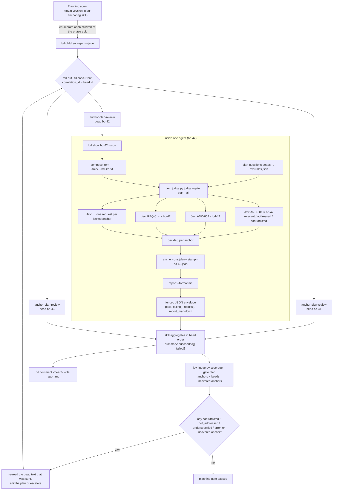
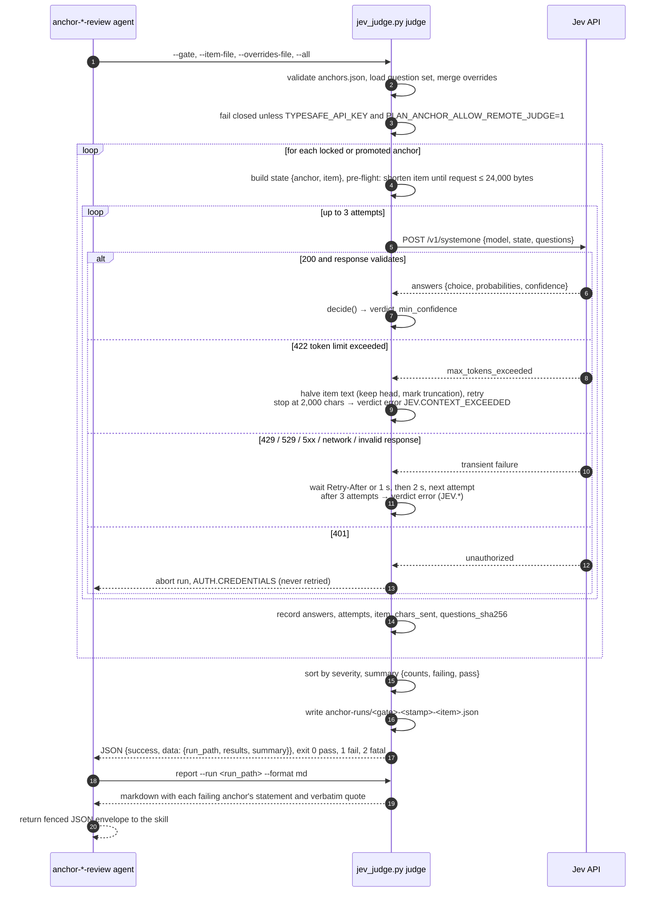
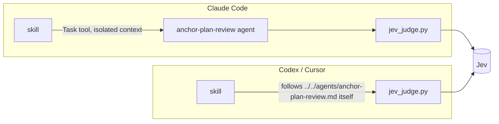

# Plan anchoring: architecture and call graphs

Design document for the `plan-anchoring` skill. Companion to the [PRD](../plan-anchor-prd.md) and to [data model, gating and lifecycle](data-model-and-gating.md). Diagrams are Mermaid.

Status: implemented and verified live against Jev `jev-1.13.0` on both gates. Revision 0.3 (2026-10-10) adds, from first use on a real plan: the statement/quote split, the testability rubric, the background question tuner, deduplication, deterministic shape metrics, and size-as-symptom handling of oversized beads. Marketplace packaging is pending.

## 1. Components

Three tiers, following the two-tier skill/agent architecture plus one external judge. Everything that must be exact lives in the script; everything that needs judgment lives in the main session or in Jev.

Responsibilities:

| Tier | Owns | Never does |
| --- | --- | --- |
| Skill (main session) | Detecting candidates, writing each as one testable statement with the verbatim quote kept, running the rubric and dedupe, locking through the script, spinning off the tuner, creating the bead tree, deciding what to judge, posting reports, triaging verdicts and oversized beads | Judging text itself, locking a statement that is just the quote, computing coverage or size by hand, splitting a bead to pass |
| Agents | Composing the exact text Jev sees, resolving question overrides from beads, invoking the script once, returning fenced JSON; the tuner rewrites one question per round and proves it against fixtures and known beads | Editing beads, the record, the plan or code; posting comments; retrying around the script; tuning to make one bead pass |
| Script | IDs, lint, rubric and dedupe requests, the Jev request, retries, response validation, gating, run files, coverage, diffs, shape metrics, report rendering | Calling `bd` or `gh`; deciding what to judge; shortening plan prose |
| Jev | Answering three or four independent typed questions about one anchor and one item | Counting, gating, explaining, seeing more than one item |

## 2. Planning gate call graph

Fan-out happens at two levels. The skill fans out across planning beads (at most three agents at once, one correlation ID each, aggregated in bead order). Inside each agent the script fans out across anchors, one Jev request per anchor, so Jev never sees two anchors or two beads together.

Request count is deterministic: locked anchors × planning beads. Twenty anchors across fifteen beads is 300 Jev requests, each about 100 ms and priced on input tokens only, so re-running after every plan edit is the intended cadence. The third identical failing run on one bead is a hard stop that escalates to the user instead of editing again.

## 3. Development gate (sprint review) call graph

The same anchors, judged against an account of delivered work instead of the plan. The quality manager drives it, the agent assembles evidence in a fixed priority order, and the development question set adds an evidence question so a claim of compliance is separated from a demonstration of it.

The two gates are separate because they judge different things. An anchor that was faithfully planned and then abandoned in code passes the planning gate and fails here. Jev only confirms the account *describes* following the directive; the paired deterministic check confirms the code did.

## 4. One judge invocation, with retries

Every call to Jev goes through the script, which owns the attempt policy. Agents call the script once and never add a retry loop of their own, so the behaviour is identical under Claude Code (agent) and Codex (skill running the agent's steps inline).

Policy summary:

| Situation | Behaviour | Where |
| --- | --- | --- |
| Request too large before sending | Shorten the item to fit 24,000 bytes, keep the head, mark truncation | script pre-flight |
| Jev reports the context window exceeded (422) | Halve the item and retry; stop below 2,000 characters with `JEV.CONTEXT_EXCEEDED` | script, per anchor |
| 429, 529, 5xx, timeout, network error, malformed response | At least two more attempts (three total) with `Retry-After` or 1 s then 2 s backoff; then `verdict: error` for that anchor only | script, per anchor |
| 401 or missing opt-in | Abort the whole run immediately; never retried; never bypassed by an agent | script pre-flight |
| Agent sees `success: false` | Return the script's error object in the fenced envelope; no second judge call | agent |
| Skill sees a failed bead among several | Report it in the aggregation summary; do not drop it or silently re-run | skill |

## 5. Two execution modes

Claude Code has subagents; Codex and Cursor do not. The agent files are written so the same steps run either way.

The script path is resolved relative to the skill directory (`scripts/jev_judge.py` next to `SKILL.md`), with `$CLAUDE_PLUGIN_ROOT/skills/plan-anchoring/scripts/jev_judge.py` as the fallback when installed as a plugin, so neither mode depends on a project-level `.claude/` path.

## 6. What leaves the machine

Only a `judge` or `check-fixtures` call contacts TypeSafe, and only after both `TYPESAFE_API_KEY` and `PLAN_ANCHOR_ALLOW_REMOTE_JUDGE=1` are set. Each request carries exactly: the anchor's testable statement and scope (the verbatim quote stays local, except in `rubric`), the item's ID, title and composed text (bead fields or the evidence account, never full diffs or source), and the question set. The key travels only as a bearer header and is never printed, logged or written to a run file. `--dry-run` writes the exact request bodies and totals to the run directory without sending anything; `--answers-file` exercises the whole pipeline with fixture answers for tests and CI.
